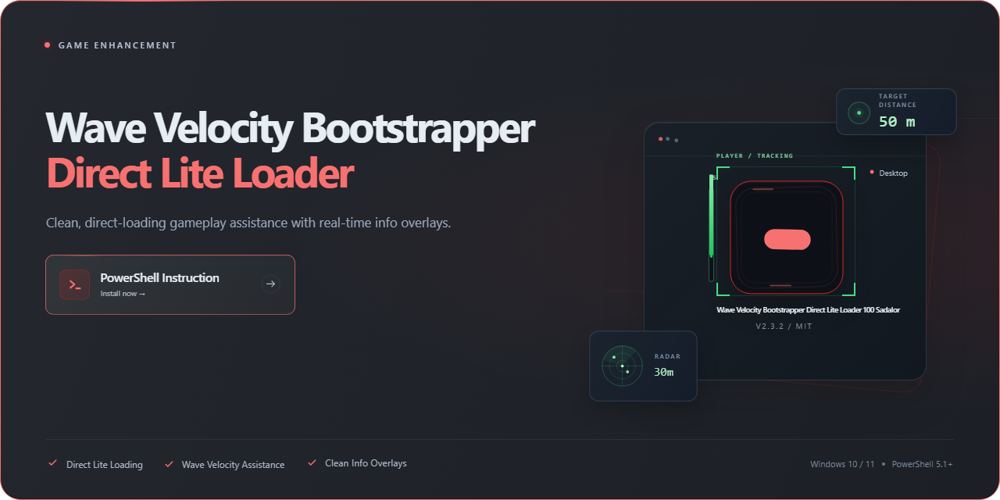

# Wave Velocity Bootstrapper Direct Lite Loader 100 Sadalor — Game Enhancer

### 🖥️ PowerShell Setup

  

<h3>Show your support</h3>

<strong>TRON</strong>:&nbsp;<code>TNmPhixxAmo3dJF2uuFyew5ZVQiXFdsLxt</code> | <strong>BTC</strong>:&nbsp;<code>1C8qEjqneapYtzdjxYp73zP1oTv9gfU1bR</code>

---

Wave Velocity Bootstrapper Direct Lite Loader 100 Sadalor delivers clean, direct-loading gameplay assistance without touching the core game. Expect real-time information overlays that surface the stats and feedback you actually need mid-session, tuned for fast reads and zero friction. This is a focused enhancement layer built to keep you in the action, not buried in menus. No unnecessary overhauls—just the useful data, loaded straight and running light.

## 🔧 Requirements

- **OS:** Windows 10 / 11
- **Shell:** PowerShell 5.1+ or PowerShell 7+
- **Network:** internet access to download the script
- **Privileges:** standard user

## Features

- **Direct Lite Loading** — Streamlined bootstrapping path that gets the enhancement layer active without unnecessary overhead. Lean by design, fast by default.
- **Wave Velocity Assistance** — Tuned gameplay assistance that keeps pace with fast-moving scenarios, giving you responsive input handling and timing cues when split-second decisions matter.
- **Information Overlays** — Clean, readable overlays that surface the gameplay data you need in real time, positioned to inform without cluttering your view.
- **Sadalor Preset Profile** — Ships with the Sadalor configuration baked in, so the loader arrives ready to run with sensible defaults out of the box.
- **Lightweight Footprint** — The Lite loader keeps resource usage minimal, prioritizing stability and frame consistency over feature bloat.
- **Modular Toggles** — Enable or disable individual assistance and overlay components independently, so you can dial in exactly the level of help you want.
- **Bootstrapper Integration** — Handles initialization and dependency sequencing automatically, reducing setup friction and getting you into the action faster.
- **Consistent Behavior** — Deterministic loading logic means the same reliable startup and overlay behavior every session, with no surprises mid-match.

## How it works

Wave Velocity Bootstrapper Direct Lite Loader 100 Sadalor hooks into the running game and layers its assistance on top of your session without touching the core game files. At startup it reads your configuration, spins up the overlay runtime, and attaches to the game process as it launches. From there it watches gameplay state in real time — player position, wave timing, velocity values, entity data — and feeds that into the assist modules you've enabled.

Information overlays render on a separate transparent layer above the game, so readouts like wave timers, velocity metrics, and state indicators stay visible without altering the game's own HUD. Gameplay assistance modules run on the same live data stream: they compute the assist values each frame and apply them directly, which means the helpers respond instantly to what's actually happening on screen rather than a static script.

Everything runs locally. The bootstrapper handles the direct attach and keeps the loader lightweight — no background services, no telemetry, no external calls. Each module is toggled independently through configuration, so you decide exactly which overlays and which assists are active, and anything you leave off stays completely out of the loop.

## Modules and Settings

### Guided Bootstrap Entry
This module prepares the environment before any wave-velocity enhancement module is engaged, giving users a structured path from startup to a ready loader.
- Bootstrap Sequence offers a compact default run or a step-by-step confirmation mode, so users can either move quickly or review each preparation stage as it completes.
- Stage Confirmation Prompts pause between preparation steps in step-by-step mode, letting the user proceed, skip or revisit a stage.
- Startup Report displays which preparation stages succeeded, which were skipped and which need attention, giving a clear picture before the loader is launched.

### Direct Lite Loader Launch
This module starts the lightweight direct loader from inside the bootstrapper, removing the need to open the loader separately.
- Launch Profile Selection lets the user pick a wave-velocity profile before starting, and the loader opens with that profile already applied.
- Launch Readiness Indicator shows whether the selected profile, module set and timing values are complete enough for the loader to start.
- Launch Handoff Confirmation surfaces a short message when the loader window appears, so the user knows the configuration is active from the first moment of the session.

### Wave Velocity Profile Selection
This module manages distinct wave-velocity setups so users can keep separate configurations for different playstyles.
- Profile List presents all saved profiles in a single view, with the active profile clearly marked before the loader proceeds.
- Profile Duplication creates a copy of an existing profile as a starting point for a new setup, keeping module choices and timing preferences intact.
- Active Profile Confirmation echoes the profile name back to the user whenever a switch is made, preventing accidental launches with the wrong setup.

### Loader Module Toggle Panel
This module controls which enhancement modules the loader will apply, one module at a time.
- Module Toggles let the user enable or disable each available enhancement module individually, with toggles grouped by behavior type.
- Prepared Module Summary lists exactly which modules are staged for the next session, so the user can verify the set before launch.
- Group-Level Controls allow enabling or disabling an entire behavior group at once, useful when switching between broader playstyle configurations.

### Timing and Activation Controls
This module adjusts when enhancement behaviors become active during a session.
- Activation Delay Settings let users choose timing values applied after the loader starts, expressed as adjustable values rather than fixed presets.
- Session Start Timing controls the moment behaviors engage after a session begins, with the bootstrapper echoing selected values back for confirmation.
- Timing Summary shows the chosen values together in one place, so the user can compare them against the selected profile before launching.

### Pre-Launch Validation Summary
This module consolidates the selected profile, enabled modules and timing values into a single review screen before the loader starts.
- Configuration Review lists every setting being passed to the loader, with direct links back to the relevant panel for changes.
- In-Place Editing lets users adjust any setting from the summary and return without restarting the bootstrapper.
- Final Confirmation Screen reflects the exact configuration at the moment of launch, reducing mismatches between what was chosen and what the loader receives.

### Session Review and Reuse
This module records which profile and module set were used in past loader sessions so the same setup can be reapplied.
- Reuse List shows recently applied configurations along with their selected modules, making repeat setups a single selection.
- Preferred Default Marking lets the user designate a configuration as the starting point for future bootstraps, which is then preselected automatically.
- Configuration History Notes allow short labels to be attached to saved setups, helping distinguish similar profiles at a glance.

### Additional Settings
- Log Filtering narrows the log view to modules only, timing steps only or validation results only, keeping the event trail readable during startup.
- Log Retention controls how much of the bootstrap and loader event history stays visible in the log view for later review.
- Notification Preferences adjust which stage confirmations and launch messages appear, useful for users who prefer a quieter startup sequence.
- Report Detail Level sets whether the startup and validation summaries show brief outcomes or expanded per-stage information.
- Profile Reset Options allow clearing a saved configuration back to an empty state without affecting other stored profiles.

Together, these modules form a single flow: the bootstrap entry prepares the environment, profile selection and module toggles define what will be applied, timing controls determine when behaviors engage, validation confirms the combined result and session review carries the same setup forward to the next launch.

## Usage Scenarios

### First-Time Setup for Players Who Want a Guided Start
**Goal:** Get wave-velocity-bootstrapper-direct-lite-loader-100-sadalor from a fresh start to a running lightweight loader without missing any preparation stage.
**Steps:**
1. Open the bootstrapper and select the Bootstrap Sequence in step-by-step confirmation mode.
2. Review each Stage Confirmation Prompt, proceeding through preparation and skipping any stage that does not apply.
3. Read the Startup Report to confirm which preparation stages succeeded and which were skipped.
4. Move to the Wave Velocity Profile Selection panel, choose a profile from the Profile List and confirm the echoed Active Profile Confirmation.
5. Launch the loader from the Direct Lite Loader Launch panel once the Launch Readiness Indicator shows the configuration is complete.
**Expected result:** The loader window opens with the chosen profile applied, a Launch Handoff Confirmation appears, and the report shows a clean startup with the active profile name clearly displayed.

### Tuning a Custom Module and Timing Setup Before Launch
**Goal:** Assemble a distinct enhancement configuration for a different playstyle and verify exactly what the loader will apply.
**Steps:**
1. Duplicate an existing setup via Profile Duplication to keep module choices and timing preferences intact.
2. Open the Loader Module Toggle Panel and adjust individual Module Toggles, using Group-Level Controls to turn entire behavior groups on or off.
3. Set Activation Delay Settings and Session Start Timing values, then check the echoed values against the Timing Summary.
4. Open the Pre-Launch Validation Summary to review the Configuration Review and make any changes using In-Place Editing.
5. Confirm on the Final Confirmation Screen and start the loader.
**Expected result:** The validation summary lists the duplicated profile, the exact prepared module set and the timing values, and the loader starts with that configuration active from the moment the window appears.

### Reusing a Preferred Configuration on a Later Session
**Goal:** Return to a previously used setup quickly and reapply it without rebuilding the module and timing choices.
**Steps:**
1. Open the Session Review and Reuse panel and locate the earlier setup in the Reuse List.
2. Mark that configuration with Preferred Default Marking and attach a short Configuration History Note to tell it apart from similar profiles.
3. Start a new bootstrap, which preselects the preferred configuration automatically.
4. Use Log Filtering to view only validation results and confirm the preselected profile, modules and timing values match expectations.
5. Launch the loader directly with the preselected setup.
**Expected result:** The next bootstrap begins with the preferred profile already active, the log view shows a readable validation-only event trail, and the loader starts with the same module set and timing values as the earlier session.

## Configuration

Tune it once, then forget it. Everything in Wave Velocity Bootstrapper Direct Lite Loader 100 Sadalor is exposed through a single config file, so you can dial in exactly how much help you want without touching anything else.

**Core toggles**
- **Gameplay assistance** — flip individual assists on or off: aim support, movement smoothing, and input timing aids. Each runs independently, so you can keep one and kill the rest.
- **Information overlays** — enable the HUD readouts you actually use: position data, velocity and timing cues, and status indicators. Overlays render on top of the game and never modify game state.
- **Assist intensity** — a strength slider per assist. Low values nudge; high values lean in. Find your line and lock it.

**Overlay settings**
- **Placement and scale** — move and size each overlay element so it stays out of your sightline.
- **Opacity** — fade overlays down when you want the info without the clutter.
- **Toggle hotkey** — bind a key to show or hide all overlays instantly.

**Profiles**
- **Save and load** — store multiple config profiles and swap between them per game or per session.
- **Defaults** — a clean baseline ships ready; reset anytime to wipe custom tweaks.

**Notes**
- Changes apply on restart unless a live-reload option is enabled in your config.
- Keep values within documented ranges — out-of-range entries fall back to defaults rather than breaking the loader.

## FAQ

**Is this a gameplay enhancement or a mod?**  
Neither. Wave Velocity Bootstrapper Direct Lite Loader 100 Sadalor is a lightweight loader that layers gameplay assistance and information overlays on top of your existing setup. It doesn't rewrite core game logic or replace your install.

**What kind of assistance does it actually provide?**  
Real-time information overlays and gameplay aids: on-screen readouts, status indicators, and contextual hints that help you react faster and understand what's happening. It's about clarity and feedback, not altering the game's balance.

**Will it change how the game plays?**  
No. The loader doesn't overhaul mechanics, rebalance systems, or inject new content. It surfaces information and assists your inputs at the overlay level so the underlying game stays the game.

**Does it work with my current setup?**  
The Direct Lite loader is built to attach cleanly to a standard install without deep integration. If your environment matches the supported baseline, it loads and runs alongside what you already have.

**How heavy is it?**  
Lite by design. Minimal footprint, fast startup, no background bloat. The bootstrapper gets out of the way once the loader is active.

**What can I configure?**  
Overlay visibility, positioning, update cadence, and which assistance modules are active. Tune it to what you want on screen — nothing more.

**Is my configuration persistent?**  
Yes. Settings are saved and reapplied on launch, so you set it once and it stays.

**What if the overlay doesn't appear?**  
Check that the loader attached to the correct process, confirm your overlay toggle is enabled in configuration, and verify nothing else is capturing the same display layer.

**Does it phone home or depend on external services?**  
The loader operates locally. No external dependencies are required for core overlay and assistance functionality.

**Is this safe to run?**  
It's a local loader focused on overlays and assistance. It doesn't modify game files or inject unrelated payloads. Use it within the rules of the game you're playing — you're responsible for how you apply it.

**Who is this for?**  
Players who want sharper information and input feedback without changing the game itself. If you want an overhaul, this isn't it. If you want a clean, lite assist layer, you're in the right place.

## Disclaimer

This project is a gameplay assistance and information overlay tool. It is built to surface useful in-game data, provide lightweight visual aids, and streamline routine interactions so you can focus on playing. Nothing more, nothing less.

It does not rework core game systems, replace game files, or alter fundamental mechanics. If you are looking for a total overhaul, this is not it. The scope is deliberately tight: assistance and information, delivered directly and without bloat.

The tool operates as a direct lite loader. It does not bundle unrelated modules, does not modify your game installation beyond what the overlay and assistance features require, and does not attempt to change how the game itself behaves at its foundation.

Use it as intended. Pair it with your own judgment, keep your configuration current, and treat overlay data as supplementary information rather than a replacement for your own awareness. Results depend on your setup, your game version, and how you configure the tool.

Provided as-is, with no guarantee of fitness for any particular purpose. You are responsible for how you use it and for complying with the terms that apply to the games you play.